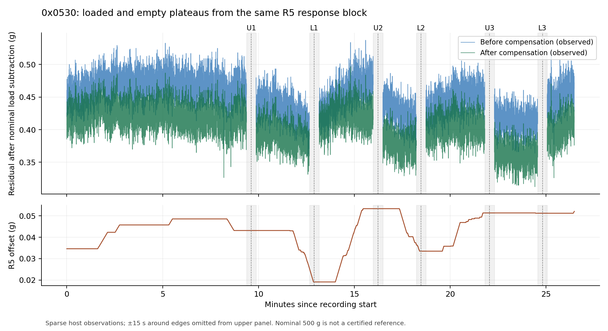

# 0x0530 空载偏差、回零与 R5 离线审查

## 结论与处置

本轮完成离线证据核对、两轮完整回零闭环分析、实际编译路径审查和软件回归。
**没有发现足以修改固件的证据；保留 0x0530。** 现有证据把空载约 0.39 g
与装卸后新增回零差区分开了，但不能唯一归因于机械回零、温漂或 R5。

分类：`OFFLINE_REVIEW_COMPLETE; ZERO_RETURN_CAUSALITY_HARDWARE_PENDING`。
本轮没有连接串口、操作设备、烧录、复位、切换 R5、置零、去皮、标定或 SAVE。
已有显示聚焦验收结论及滴水 `NOT RUN`、面板目视 `NOT OBSERVED` 保持原范围。

- 固件源码固定：`a2174ede65a1927ae491e73289c95bdcaa97deb5`。
- 本轮证据基线：`5913167f904a8783b3547ea33ab0d471bd80789d`。
- 原始目录：`Results/stage5p_0530_hardware/20261016T083710Z_0530_focus/`。
- 派生结果：`Results/stage5p_0530_zero_return_review/software/`。
- 冻结 BIN：98,796 B，SHA-256
  `8ADB103085629F9A0F645CA25F324C6B53DDB395C714E62D1C0306ED7CBCBA34`。

## 证据完整性与可观测性

硬件 manifest 的 **66 项文件**逐一校验长度与 SHA-256，全部一致。
配置区前后字节相同。四组记录恢复 **23,079 行 / 184,632 条 TX/RX 帧**，
逐帧检查 CRC、Unit、FC03、长度、请求顺序和响应匹配，并与每行 CSV 的
22 个数值字段核对，全部一致。所有记录为 ACTIVE+STATIC、tare=0，
无 fault/overrun、设备序列倒退或 SAVE 计数变化。

| 记录 | 行数 | 校验帧数 | R5 同响应算术不一致 |
|---|---:|---:|---:|
| 0x052E 静载基线 | 1,150 | 9,200 | 0 |
| 0x0530 静载 120 s | 1,144 | 9,152 | 0 |
| 0x0530 静载 600 s | 5,660 | 45,280 | 0 |
| 0x0530 装卸 | 15,125 | 121,000 | 0 |

原 CSV 每行拼接四个独立 FC03 请求。原始 `0x0280 / 40` 响应还包含 CSV
未展开的补偿前重量、补偿后重量、参考值及重建计数，本轮已恢复为压缩 CSV。
寄存器读取在单线程主循环同步完成，UART/DMA ISR 不修改计量状态，因此
**同一个 R5 响应内**可以核对：

`r5_corrected_ug = r5_uncompensated_ug - r5_offset_ug`

这不使整个 CSV 行原子化，也不等同于同一采样的权威重量/显示/ADC 证明。
主机约 9.5 Hz，装卸记录最大轮询间隔 156 ms；缺失的 40 Hz 转换未插值、
未补造、未送入 R5 重新运行。四组恢复数据是解码，不是算法全速重放。

## 完整闭环只有两组

原记录顺序为：已加载 → Unload1 → Load1 → Unload2 → Load2 → Unload3 → Load3。
开始前的空载平台与最后一次加载后的连续卸载平台均未录入。
较晚的空载预检只有单点，不能补成第三个完整回零闭环。

因此本轮只比较 Load1→Unload2、Load2→Unload3 两组完整闭环。
边沿取自 250 g 权威重量阈值的相邻主机观察；人工回复不是精确动作时刻。

预先统一窗口：加载前 `[-45,-15)` 秒、卸载后 `[15,45)` 秒，各 30 秒。
不按 official stable 筛掉样本；同时报告稳定比例、分布和时间覆盖。
窗口若短缺、跨越载荷状态或有超过 250 ms 的轮询间断，即标记不完整。

| 完整闭环 | 加载前空载净重中位数 | 卸载后 15–45 s 中位数 | 差值 |
|---|---:|---:|---:|
| Load1→Unload2 | 0.382554 g | 0.388178 g | **+0.005624 g** |
| Load2→Unload3 | 0.376788 g | 0.366517 g | **−0.010271 g** |

上述空载比较窗口的 official stable 均为真。它们是平台差的观测值，没有
预设计量合格阈值，也没有砝码证书、温度或同步 OFF 对照，**不标回零 PASS**。

等待时间会影响结论，不能只选择一个最有利窗口：

| 完整闭环 | 卸载后 15–45 s | 卸载后 60–90 s | 卸载后 90–120 s |
|---|---:|---:|---:|
| Load1→Unload2，相对同一加载前平台 | +0.005624 g | −0.007611 g | −0.005766 g |
| Load2→Unload3，相对同一加载前平台 | −0.010271 g | −0.013650 g | −0.019282 g |

若改为比较相邻两次卸载后相同年龄的 `[15,45)` 秒平台，差值分别为
−0.007945 g、−0.021661 g。不同参照本身就给出不同结果，说明应固定
下一轮物理等待时间，并保留持续变化过程。

三次加载的早期净增量中位数分别为 500.027462、500.021101、500.034917 g。
这是本次平台相减值；不把“名义 500 g”当作已知真值来宣称准确度合格。

## R5 的算术影响与显示偏差

为避免“中位数之差可以逐项相加”的错误，分解使用**同一 R5 响应数据的均值**：

| 完整闭环，前述早期窗口 | Δ补偿前重量 | Δoffset | Δ补偿后重量 |
|---|---:|---:|---:|
| Load1→Unload2 | +0.028715 g | +0.022224 g | +0.006491 g |
| Load2→Unload3 | −0.000207 g | +0.011614 g | −0.011822 g |

逐行等式无误，未舍入的均值差满足 `Δ补偿后 = Δ补偿前 − Δoffset`。
第二轮中，补偿前均值变化很小，而 offset 增加约 0.0116 g，足以在算术上
解释该窗口的大部分补偿后差值。它**不证明 R5 在同一真实输入下总体有害或有益**；
没有 OFF 对照，也没有连续全速输入可做相同初始状态的反事实重放。

上表和权威净重中位数表来自不同 FC03 请求、不同统计量，不能把它们强行
逐样本对齐。更晚等待窗口里，补偿前重量本身也在变化。

卸载后早期的补偿前中位数约 0.416–0.443 g，补偿后约 0.364–0.397 g。
空载残值已存在于显示之前。本次装卸记录中，显示值与同一实时块权威净重的
观测差范围为 −0.065619～+0.084032 g；这是历史保持/量化的观测差，
不是零点偏置。现有记录不支持“显示算法制造了约 0.39 g 偏置”的判断。



图中加载平台扣除了名义 500 g，便于与空载平台共同查看。上图省略每个边沿
前后各 15 秒，灰色带明确标示；未插值。图中的补偿前曲线是观测字段，
不是关闭 R5 后重新做的一组实板试验，也不是计量误差曲线。

## 源码路径审查

本 BIN 开启 `A33_ENABLE_STAGE5PA13C_SHADOW` 和 `A33_ENABLE_STAGE5PA13E_ACTIVE`。
`App/metrology_manager.c` 的兼容层把公开 R5 接口接到
`Domain/measurement/a13c_shadow_compensator.c`，不是旧的
`reference_lock_drift_compensator.c` 长窗口控制器。

- 40 Hz 物理采样连续检查时间/序列，每四个样本准入一次控制器，逻辑约 10 Hz。
- 当前参考窗口 300 个控制样本（30 s）、观察窗口 200 个（20 s）、hold 150 个（15 s）。
- 当前集成标志下普通修正上限 25 µg/控制样本，boost 上限 50 µg/控制样本，
  即约 0.015 / 0.030 g/min；offset 上限绝对值 0.5 g。
- 参考由当前的 `mass - offset` 平台建立，目标不是数值零；自然加载事件重建
  参考时保留 offset。实测空载参考约 0.365–0.397 g，与此一致。
- OFF 会重置 offset；DOSING 会冻结当前 offset。直接开关 R5 会改变状态和
  参考历史，不是无需解释的中性 A/B 操作。
- `WeightEngine` 先计算标定/运行时零点处理后的未补偿毛重，再减 applied offset、
  再减 tare。DisplayConditioner 在最终权威重量之后，不能写回 ADC 或计量结果。

例如末次预检的 offset 约 −0.219089 g，负 offset 按设计会抬高最终重量。
用该次跨请求预检的净重加 offset，未补偿重量近似为 0.166700 g。
这只是对符号和数量级的说明，不作为同采样等式证据。
本轮原始帧内的负/正有符号解码测试也均通过。

旧 R5 兼容寄存器的部分 error/rate/evaluation 字段由适配器置零，不能据此
声称控制器没有修正；后续应结合 `0x0300` 的 A13C state/reason/event 字段。

## 软件验证与交付

- 完整严格 Host Debug **52/52**、Release **52/52** CTest。
- `Tools/stage5_unified` Python **36/36**，其中新增证据/只读采集合同 **19** 项。
- 新增 4 个合成 C 场景：正/负固定偏置保留、正/负漂移后加载/卸载 offset 保留，
  并检查 DOSING 冻结和 OFF 重置；严格构建与 ASan+UBSan 均通过。
  LeakSanitizer 因执行环境限制关闭，不据此作目标端资源结论。
- 固件生产源码与 `a2174ede...` 的相应路径逐一比较无差异；新增内容只涉及
  Host 测试、离线/只读工具、报告和派生证据。本轮没有编译新的 ARM BIN。

复算：

```text
python Tools/stage5_unified/analyze_zero_return_0530.py --evidence Results/stage5p_0530_hardware/20261016T083710Z_0530_focus --output <新的输出目录>
python -m unittest discover -s Tools/stage5_unified -p "test_zero_return*.py" -v
```

下一步的最小补证：保留当前已保存配置和 R5 状态，先连续记录空载基线，
再做三轮完整“空载→500 g→空载”，每个平台固定等待时间；同一个 FC03
响应直接记录权威未补偿/补偿后重量、applied offset、tare、sequence。
独立诊断块仍按独立请求标识，不伪装为完整原子快照。

只读采集工具与可执行提示词见
`Tools/stage5_unified/capture_zero_return_0530.py`、
`Docs/STAGE5P_0530_ZERO_RETURN_LOCAL_CODEX_PROMPT.md`。
交付包还包含基于验收提交的二进制补丁与文件树摘要，可直接在本地独立
worktree 导入，不依赖远端审查分支。报告和派生数据的本地归档已完成。
该补证尚未执行；机械/温度/R5 因果门禁仍开放。若将来要做 R5 开关对照，
需单独定义状态重建与相同物理条件，本轮不包含该操作。
